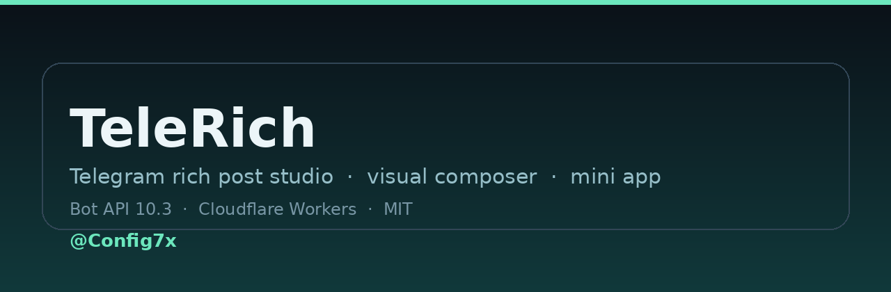
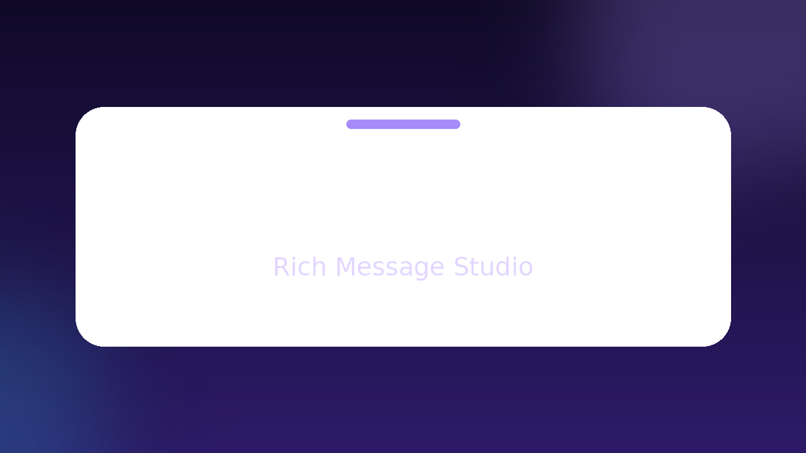
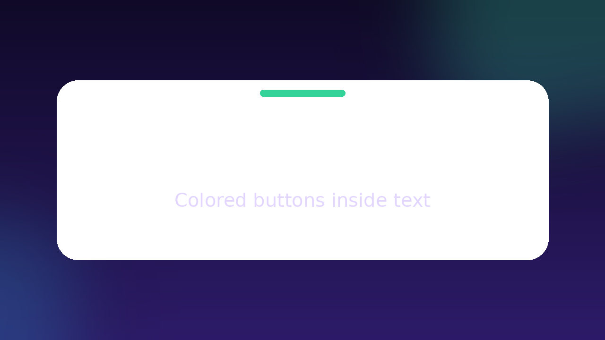

<div align="center">


# TeleRich

**استودیوی ساخت، طراحی و انتشار پست‌های ریچ تلگرام — روی Cloudflare Workers**

*Telegram rich post studio · 86-block visual composer · Mini App · Bot API 10.3*

<a href="https://t.me/Rich7xbot"></a>
<a href="https://telerich.config7x.dpdns.org"></a>
<a href="https://t.me/Config7x"></a>


<br/>



<br/>

<a href="#-فارسی">🇮🇷 فارسی</a> · <a href="#-english">🇬🇧 English</a>

</div>

---

## 🇮🇷 فارسی

### 📌 این پروژه چیست؟

TeleRich یک استودیوی کامل برای ساختن پست‌های کانال تلگرام است که **بدون یک خط کد** کار می‌کند: یک مینی‌اپ React که داخل ربات باز می‌شود، ۸۶ بلوک آماده دارد، پیش‌نمایش زندهٔ شبیه‌ساز تلگرام می‌دهد و پست را مستقیم در کانال منتشر می‌کند. کل سرویس روی **Cloudflare Workers** اجرا می‌شود؛ نه سرور لازم است، نه دامنهٔ جدا برای مینی‌اپ.

<b>ربات زنده:</b> <a href="https://t.me/Rich7xbot">@Rich7xbot</a> · <b>استودیو:</b> <a href="https://telerich.config7x.dpdns.org">telerich.config7x.dpdns.org</a>

### ✨ ویژگی‌ها

**۱. سازندهٔ بصری — بدون کد**
• هر بلوک چند فیلد ساده است؛ تگ و فرمت را موتور پست می‌سازد، نه کاربر
• افزودن، جابه‌جایی، تکثیر و حذف بلوک با یک لمس
• پیش‌نمایش زنده در قاب گوشی، هم‌زمان با ویرایش
• ذخیرهٔ خودکار بوم؛ با بستن مینی‌اپ چیزی از دست نمی‌رود

**۲. ویرایشگر متن ریچ (Markdown و HTML)**
• بولد، ایتالیک، زیرخط، خط‌خورده، اسپویلر، هایلایت، کد و بلوک کد
• بلاک‌کوت ساده و بلاک‌کوت بازشونده، `aside`، جدول، ساعت زندهٔ یونیکس، فرمول LaTeX
• تشخیص خودکار RTL/LTR برای فارسی و انگلیسی در کنار هم
• ایموجی سفارشی، منشن با شناسهٔ عددی و پانوشت

**۳. دکمه‌های ریچ درون متن**
• ردیف دکمه با استایل `success` / `primary` / `danger`
• دو نوع اکشن: لینک و کپی‌متن (برای کانفیگ، یوزرنیم، کد تخفیف)

**۴. انتشار در کانال**
• ارسال، ویرایش و حذف پست، آلبوم و فایل
• بررسی واقعی دسترسی: ربات باید ادمین کانال باشد و اجازهٔ پست داشته باشد
• محدودیت نرخ و صف ارسال برای جلوگیری از خطای FloodWait

**۵. سهمیه، دعوت و پنل مالک**
• سهمیهٔ رایگان، افزایش با دعوت دوستان، معافیت کامل برای مالک
• `/stats` برای گزارش ربات، `/admin` برای مدیریت کاربران و سهمیه‌ها
• پیام همگانی با پیش‌نمایش و تأیید

**۶. بریج خودمیزبان**
• فایل `telegram-web-app.js` از خود ورکر سرو می‌شود تا مینی‌اپ در شبکه‌هایی که `telegram.org` فیلتر است هم باز شود

### 🖼 تصویرها

| استودیو | سازندهٔ بصری |
|---|---|
|  |  |

### 📚 آموزش‌ها

| صفحه | موضوع |
|---|---|
| [`docs/guides/rich-html.md`](./docs/guides/rich-html.md) | مرجع تگ‌های متن ریچ |
| [`docs/guides/blocks.md`](./docs/guides/blocks.md) | ۸۶ بلوک و فیلدهایشان |
| [`docs/guides/buttons.md`](./docs/guides/buttons.md) | دکمه‌های ریچ و استایل‌ها |
| [`docs/guides/media.md`](./docs/guides/media.md) | عکس، آلبوم، فایل و ویدیو |
| [`docs/guides/tables.md`](./docs/guides/tables.md) | جدول، نمودار و کارت آمار |
| [`docs/guides/publishing.md`](./docs/guides/publishing.md) | انتشار، ویرایش و سهمیه |

### 🧩 کتابخانهٔ بلوک‌ها — ۸۶ بلوک در ۹ دسته

| دسته | تعداد | نمونه‌ها |
|---|---|---|
| رایج | ۱۲ | متن، عنوان، تصویر، آهنگ، اسلایدشو، کلاژ، نقشه، دکمه |
| متن | ۱۲ | نقل‌قول بازشونده، بنر تیتر، اسپویلر، کد کپی‌شو، کادر هشدار، خلاصه |
| رسانه | ۱۰ | پادکست، پلی‌لیست، کارت موزیک، ویدیو، لینک، گیف، ویس |
| داده | ۱۲ | جدول، نمودار میله‌ای و خطی، آمار، مقایسه، خط زمانی، چک‌لیست، پیشرفت |
| فروش | ۱۱ | کارت محصول، جدول قیمت، پلن‌ها، تایمر آفری، کد تخفیف، فاکتور |
| تعامل | ۷ | کوییز، قرعه‌کشی، فرم، نظرسنجی، سؤال ناشناس، اشتراک‌گذاری |
| کانال | ۶ | هدر برند، امضای پست، سری پست، دو زبانه، تغییرات نسخه |
| فنی | ۷ | کانفیگ کپی‌شو، جدول دانلود، مراحل نصب، عیب‌یابی، مشخصات |
| پیشرفته | ۵ | زمان زنده، جعبهٔ فکر، پانوشت، آموزش گام‌به‌گام |

### 🎨 قالب‌های آماده

هر بلوک با محتوای نمونه آماده است — یک لمس و بلوک پرشده روی بوم می‌نشیند. سه چیدمان ترکیبی هم هست:

| قالب | برای چه |
|---|---|
| 🛰 پست کانفیگ | کانفیگ V2Ray داخل بلاک‌کوت تودرتو + دکمهٔ کپی |
| 📢 اطلاعیه | تیتر، متن و دکمهٔ کانال |
| 📚 آموزش قدم‌به‌قدم | بخش‌های بازشو با مراحل |
| 🛍 پیشنهاد فروش | محصول، قیمت و دکمهٔ خرید |
| 👤 معرفی پروفایل | مشخصات و روش‌های ارتباط |
| ✨ از صفر | بوم خالی برای شروع آزاد |
| 📚 پست چندحالته | خلاصه، نقل‌قول بازشو و پرسش‌های متداول |
| 🎞 اسلایدشو | هدر برند + اسلایدشو + دکمه |
| 📊 نظرسنجی زنده | تیتر، نظرسنجی و اشتراک‌گذاری |

### 🚀 شروع سریع

```bash
git clone https://github.com/Config7x/TeleRich.git
cd TeleRich
npm install
npm run build          # مینی‌اپ را می‌سازد و در worker/index.js تزریق می‌کند
npm test               # ۱۳ تست
npx wrangler deploy    # انتشار روی اکانت کلادفلر خودت
```

سپس سه مقدار را ست کن و وبهوک را ثبت کن:

```bash
npx wrangler secret put BOT_TOKEN        # توکن ربات از BotFather
npx wrangler secret put WEBHOOK_SECRET   # یک رشتهٔ تصادفی
npx wrangler secret put ADMIN_KEY        # کلید پنل ادمین استودیو
# بعد از دیپلوی، یک‌بار /start نکن؛ مستقیم ست کن:
#   POST /api/webhook  با هدر Authorization: Bearer <ADMIN_KEY>
```

جزئیات کامل: [`docs/self-host.md`](./docs/self-host.md)

### 🗂 ساختار پروژه

```
TeleRich/
├─ worker/              # ورکر کلادفلر: ربات + API استودیو
│  ├─ worker.js
│  ├─ index.js          # ساخته‌شده: HTML مینی‌اپ + دادهٔ راهنما
│  └─ tg-web-app-content.js
├─ miniapp/             # مینی‌اپ React (تک‌فایل)
│  ├─ index.html
│  ├─ vite.config.ts
│  └─ src/{App,Composer,Renderer,blocks,library,content}.{tsx,ts}
├─ tools/build-worker.mjs
├─ tests/               # node:test
├─ docs/                # architecture · api · composer · self-host · guides
├─ media/promo/         # اسلایدهای تبلیغاتی
├─ banner.png · logo.png
├─ package.json · wrangler.jsonc · Dockerfile
└─ README · CHANGELOG · SECURITY · CONTRIBUTING · CODE_OF_CONDUCT
```

### 🛠 دستورات ربات

| دستور | کار |
|---|---|
| `/start` | منوی اصلی و دکمهٔ باز کردن استودیو |
| `/webapp` | باز کردن مستقیم مینی‌اپ |
| `/post` | پست‌ساز کانال |
| `/guide` | راهنمای متن ریچ |
| `/html` | راهنمای بلوک‌ها و چیدمان |
| `/media` | راهنمای مدیا |
| `/buttons` | نمونهٔ دکمه‌های ریچ |
| `/table` | نمونهٔ جدول |
| `/demo` | دموی کامل همهٔ قابلیت‌ها |
| `/updates` | تغییرات Bot API 10.3 |
| `/ref` | سهمیه و لینک دعوت |
| `/whoami` | شناسهٔ عددی شما |
| `/stats` | گزارش ربات (مالک) |
| `/admin` | مدیریت کاربران و سهمیه (مالک) |

### 🔌 API استودیو

همه از نوع `POST /api/<action>` با احراز هویت `Telegram initData` (از داخل مینی‌اپ) یا `Authorization: Bearer <ADMIN_KEY>` برای اپراتور.

| مسیر | کار |
|---|---|
| `connect` | بررسی اتصال ربات (`getMe`) |
| `webhook` | ثبت وبهوک، دستورات و منو (فقط اپراتور) |
| `send` / `edit` / `delete` | ارسال، ویرایش و حذف پیام در مقصد |
| `channel` | فهرست کانال‌های قابل انتشار با بررسی دسترسی |
| `publish` | انتشار پست ساخته‌شده |
| `draft` | ذخیره و بازیابی پیش‌نویس |
| `quota` | سهمیه و لینک دعوت |
| `render` | رندر امن HTML ریچ بدون ارسال |

### 🧪 تست و توسعه

```bash
npm test          # سوئیت node:test
npm run dev       # اجرای محلی مینی‌اپ با Vite
```

تست‌ها شامل: خروجی غیرخالی و تگ‌های متوازن برای **همهٔ ۸۶ بلوک**، جلوگیری از تزریق HTML در متن کاربر، صحت دکمه‌های کپی و لینک، و اینکه باندل ورکر حتماً سازندهٔ بصری و بریج خودمیزبان را داشته باشد.

### 🔐 امنیت

• هیچ توکن یا کلیدی داخل کد نیست؛ همه از `secret` های کلادفلر می‌آید
• اعتبارسنجی `initData` با HMAC و بررسی زمان انقضا
• پنل اپراتور با `ADMIN_KEY` و مقایسهٔ ثابت‌زمان (constant-time)
• وبهوک با `x-telegram-bot-api-secret-token` بررسی می‌شود
• اکشن‌های حساس فقط برای مالک، با بررسی واقعی دسترسی ربات در مقصد

جزئیات و راه گزارش آسیب‌پذیری: [`SECURITY.md`](./SECURITY.md)

### 📄 لایسنس

MIT — استفاده، تغییر و انتشار آزاد است. فایل [`LICENSE`](./LICENSE).

<div align="center">

**ساختهٔ <a href="https://github.com/Config7x">Config7x</a>** · کانال: <a href="https://t.me/Config7x">@Config7x</a> · ربات: <a href="https://t.me/Rich7xbot">@Rich7xbot</a>

⭐ اگر به کارت آمد، یک ستاره بده: <a href="https://github.com/Config7x/TeleRich">github.com/Config7x/TeleRich</a>

</div>

---

## 🇬🇧 English

### 📌 What is this project?

TeleRich is a complete studio for building Telegram channel posts **without writing a single tag**: a React mini app that opens inside a bot, ships **86 ready blocks**, gives a live Telegram-like preview and publishes straight to a channel. Everything runs on **Cloudflare Workers** — no server, no separate hosting for the mini app.

<b>Live bot:</b> <a href="https://t.me/Rich7xbot">@Rich7xbot</a> · <b>Studio:</b> <a href="https://telerich.config7x.dpdns.org">telerich.config7x.dpdns.org</a>

### ✨ Features

**1. Visual composer — no code**
• Every block is a few plain fields; the renderer owns all tag/format work
• Add, reorder, duplicate and delete blocks with one tap
• Live preview in a phone frame while you edit
• Canvas autosaves, so closing the mini app loses nothing

**2. Rich text editor (Markdown & HTML)**
• Bold, italic, underline, strike, spoiler, highlight, inline and block code
• Simple and expandable blockquotes, `aside`, tables, `<tg-time>`, LaTeX math
• Automatic RTL/LTR detection for Persian next to English
• Custom emoji, numeric-ID mentions and footnotes

**3. Rich buttons inside the message**
• Button rows with `success` / `primary` / `danger` styles
• Two action types: URL and copy-text (configs, usernames, coupons)

**4. Channel publishing**
• Send, edit and delete posts, albums and files
• Real permission checks: the bot must be a channel admin with post rights
• Rate limiting and a send queue to avoid FloodWait

**5. Quota, referrals and owner panel**
• Free quota, bonus credits for inviting friends, full exemption for the owner
• `/stats` for the bot report, `/admin` for users and quotas
• Broadcast with preview and confirmation

**6. Self-hosted bridge**
• `telegram-web-app.js` is served by the worker itself, so the mini app still opens where `telegram.org` is filtered

### 🖼 Screenshots

| Studio | Visual composer |
|---|---|
|  |  |

### 📚 Guides

[rich text reference](./docs/guides/rich-html.md) · [the 86 blocks](./docs/guides/blocks.md) · [rich buttons](./docs/guides/buttons.md) · [media](./docs/guides/media.md) · [tables & charts](./docs/guides/tables.md) · [publishing & quota](./docs/guides/publishing.md)

### 🧩 Block library — 86 blocks across 9 categories

| Category | Count | Examples |
|---|---|---|
| Common | 12 | text, heading, image, audio, slideshow, collage, map, button |
| Text | 12 | expandable quote, title banner, spoiler, copyable code, callout, TL;DR |
| Media | 10 | podcast, playlist, music card, video, link card, GIF, voice |
| Data | 12 | table, bar/line chart, stat card, comparison, timeline, checklist, progress |
| Sales | 11 | product card, price table, plans, offer countdown, coupon, invoice |
| Engagement | 7 | quiz, giveaway, form, poll, anonymous question, share |
| Channel | 6 | brand header, post signature, series, bilingual, changelog |
| Technical | 7 | copyable config, download table, install steps, troubleshooting, specs |
| Advanced | 5 | live time, thinking box, footnote, step-by-step guide |

### 🎨 Ready templates

Every block arrives prefilled — one tap puts a finished block on the canvas. Three composed layouts are included as well: multi-level post, slideshow post and live poll, plus the six starter templates (config post, announcement, tutorial, sale, profile, blank).

### 🚀 Quick start

```bash
git clone https://github.com/Config7x/TeleRich.git
cd TeleRich
npm install
npm run build          # builds the mini app and inlines it into worker/index.js
npm test               # 13 tests
npx wrangler deploy    # ship to your own Cloudflare account
```

Then set three secrets and register the webhook:

```bash
npx wrangler secret put BOT_TOKEN
npx wrangler secret put WEBHOOK_SECRET
npx wrangler secret put ADMIN_KEY
# after deploying: POST /api/webhook with Authorization: Bearer <ADMIN_KEY>
```

Full guide: [`docs/self-host.md`](./docs/self-host.md) · architecture: [`docs/architecture.md`](./docs/architecture.md) · API: [`docs/api.md`](./docs/api.md) · composer: [`docs/composer.md`](./docs/composer.md)

### 🗂 Project structure

```
TeleRich/
├─ worker/              # edge entry: bot + studio API
│  ├─ worker.js
│  ├─ index.js          # generated: studio HTML + guide data
│  └─ tg-web-app-content.js
├─ miniapp/             # React mini app (single file build)
│  ├─ index.html
│  ├─ vite.config.ts
│  └─ src/{App,Composer,Renderer,blocks,library,content}.{tsx,ts}
├─ tools/build-worker.mjs
├─ tests/               # node:test
├─ docs/                # architecture · api · composer · self-host · guides
├─ media/promo/
├─ banner.png · logo.png
├─ package.json · wrangler.jsonc · Dockerfile
└─ README · CHANGELOG · SECURITY · CONTRIBUTING · CODE_OF_CONDUCT
```

### 🛠 Bot commands

`/start` main menu · `/webapp` open the studio · `/post` channel studio · `/guide` rich text guide · `/html` blocks & layout · `/media` media guide · `/buttons` rich buttons · `/table` table sample · `/demo` full demo · `/updates` Bot API 10.3 changes · `/ref` quota & invite link · `/whoami` your numeric ID · `/stats` bot report (owner) · `/admin` users & quotas (owner)

### 🔌 Studio API

All endpoints are `POST /api/<action>` authenticated with Telegram `initData` (from the mini app) or `Authorization: Bearer <ADMIN_KEY>` for the operator: `connect`, `webhook`, `send`, `edit`, `delete`, `channel`, `publish`, `draft`, `quota`, `render`.

### 🧪 Tests

```bash
npm test
```

Covers: non-empty, tag-balanced output for **all 86 blocks**, HTML-injection safety for user text, copy/URL button payloads, and that the worker bundle always contains the visual composer and the self-hosted bridge.

### 🔐 Security

No secrets in code (all from Cloudflare secrets) · `initData` HMAC validation with expiry · constant-time `ADMIN_KEY` comparison · webhook verified via `x-telegram-bot-api-secret-token` · sensitive actions owner-only with real destination permission checks. See [`SECURITY.md`](./SECURITY.md).

### 📄 License

MIT — free to use, modify and redistribute. See [`LICENSE`](./LICENSE).

<div align="center">

**Built by <a href="https://github.com/Config7x">Config7x</a>** · Channel: <a href="https://t.me/Config7x">@Config7x</a> · Bot: <a href="https://t.me/Rich7xbot">@Rich7xbot</a>

⭐ If this helped you, star it: <a href="https://github.com/Config7x/TeleRich">github.com/Config7x/TeleRich</a>

</div>
